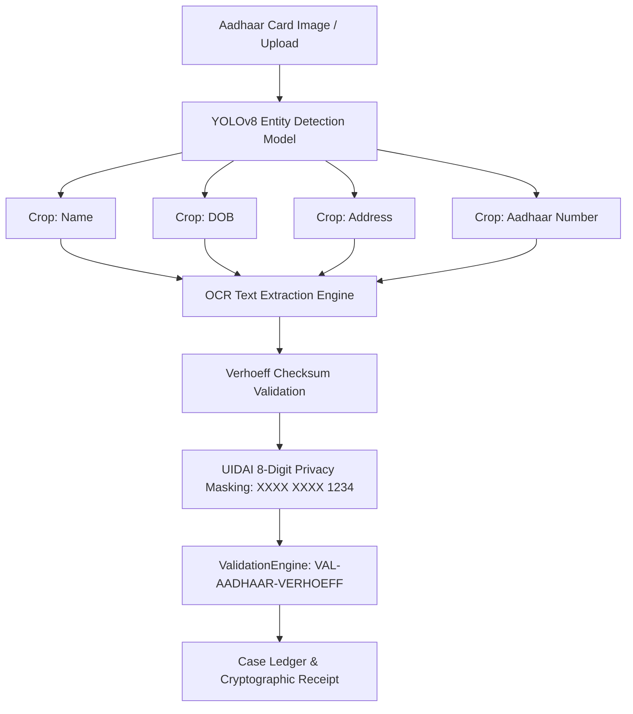

# Aadhaar Card YOLOv8 Entity Detection & Validation Engine Guide

## 1. Overview & Dataset Profile

This guide documents the end-to-end integration of the **Aadhaar Card Entity Detection** dataset into the AI Identity & Digital Trust Automation Platform.

- **Dataset Source:** [Roboflow Universe — Aadhar Card Entity Detection (v1)](https://universe.roboflow.com/jizo/aadhar-card-entity-detection)
- **License:** CC BY 4.0
- **Total Images:** 2,646 images
- **Annotation Format:** YOLOv8 bounding boxes
- **Target Annotated Classes:**
  1. `aadhar_number` — 12-digit national identity number
  2. `name` — Citizen legal full name
  3. `dob` — Date of Birth (or Year of Birth)
  4. `address` — Residential postal address
- **Preprocessing Applied:**
  - Auto-orientation of pixel data (EXIF-orientation stripping)
  - Resized to 640x640 (Stretch)

---

## 2. Platform Architecture

The Aadhaar Card processing subsystem integrates computer vision, deterministic cryptographic math, and regulatory privacy controls:



### Key Technical Capabilities:
1. **YOLOv8 Object Detection:** Localizes exact bounding coordinates for the four key identity fields.
2. **Crop & OCR Ingestion:** Isolates text blocks for clean, high-confidence character recognition.
3. **Verhoeff Checksum Algorithm:** Mathematical validation using the base-10 dihedral group $D_5$ multiplication table to detect all single-digit errors and 100% of adjacent digit transpositions.
4. **UIDAI Privacy Compliance:** First 8 digits are permanently masked (`XXXX XXXX 1234`), storing only the last 4 digits in plain display and an irreversible SHA-256 hash for deduplication.

---

## 3. Environment & Prerequisites

To train or fine-tune YOLOv8 on GPU or CPU:

```bash
# 1. Install Computer Vision & Training Dependencies
pip install ultralytics roboflow opencv-python pytesseract pillow

# 2. Verify PyTorch GPU support (Optional, for fast training)
python -c "import torch; print('CUDA available:', torch.cuda.is_available())"
```

---

## 4. Downloading the Dataset & Training the Model

The platform includes a dedicated automation script: [`scripts/train_aadhaar_yolov8.py`](file:///c:/Users/sakth/ai%20identity%20and%20digital%20automation/scripts/train_aadhaar_yolov8.py).

### Step 4.1: Verify Script in Dry-Run Mode
```bash
python scripts/train_aadhaar_yolov8.py --dry-run
```

### Step 4.2: Download the Dataset Only
To download the dataset in YOLOv8 format using your Roboflow API key:
```bash
python scripts/train_aadhaar_yolov8.py \
    --api-key YOUR_ROBOFLOW_API_KEY \
    --download-only
```

### Step 4.3: Full Model Training & Weight Export
Train a YOLOv8 nano model (`yolov8n.pt`) for 50 epochs:
```bash
python scripts/train_aadhaar_yolov8.py \
    --api-key YOUR_ROBOFLOW_API_KEY \
    --model yolov8n.pt \
    --epochs 50 \
    --batch 16 \
    --imgsz 640 \
    --export-onnx
```

When training completes, the script automatically copies `best.pt` to:
`backend/app/models/weights/aadhaar_yolov8.pt`

Once this file is present, `AadhaarEntityDetectionService` automatically switches from heuristic fallback to live YOLOv8 model inference.

---

## 5. Backend REST API Endpoints

The Aadhaar subsystem exposes the following endpoints under `/api/v1/aadhaar`:

### 1. `POST /api/v1/aadhaar/validate-number`
Validates any 12-digit Aadhaar number against the Verhoeff algorithm.

- **Request Body:**
  ```json
  {
    "aadhar_number": "3675 9832 4152"
  }
  ```
- **Response (HTTP 200 OK):**
  ```json
  {
    "is_valid": true,
    "error_code": null,
    "message": "Aadhaar number is structurally and cryptographically valid",
    "cleaned_number": "367598324152",
    "masked_number": "XXXX XXXX 4152",
    "sha256_hash": "f9355484c7c872c83c6d49ada16067a1efe610a94745526784aaa61d745c8941"
  }
  ```

### 2. `POST /api/v1/aadhaar/detect-and-extract`
Performs entity detection, OCR extraction, and Verhoeff validation from an uploaded image or default synthetic sample.

- **Request:** Multipart form upload (`file`) or empty body (runs synthetic Aadhaar test).
- **Response (HTTP 200 OK):**
  ```json
  {
    "status": "SUCCESS",
    "case_id": null,
    "file_id": "upload_direct",
    "detected_entities": {
      "name": {
        "text": "Aarav Sharma",
        "confidence": 0.94,
        "bbox": { "label": "name", "x_min": 220, "y_min": 120, "width": 330, "height": 40 }
      },
      "dob": {
        "text": "1994-08-15",
        "confidence": 0.92,
        "bbox": { "label": "dob", "x_min": 220, "y_min": 165, "width": 230, "height": 40 }
      },
      "address": {
        "text": "H No 42, Gandhi Road, T Nagar, Chennai, Tamil Nadu - 600017",
        "confidence": 0.89,
        "bbox": { "label": "address", "x_min": 220, "y_min": 210, "width": 500, "height": 70 }
      },
      "aadhar_number": {
        "text": "3675 9832 4152",
        "confidence": 0.97,
        "bbox": { "label": "aadhar_number", "x_min": 220, "y_min": 330, "width": 380, "height": 50 }
      }
    },
    "extracted_fields": {
      "full_name": "Aarav Sharma",
      "date_of_birth": "1994-08-15",
      "address": "H No 42, Gandhi Road, T Nagar, Chennai, Tamil Nadu - 600017",
      "document_number": "367598324152",
      "masked_document_number": "XXXX XXXX 4152",
      "country": "IND"
    },
    "bounding_boxes": [...],
    "verhoeff_valid": true,
    "masked_number": "XXXX XXXX 4152",
    "detection_method": "HEURISTIC_SYNTHETIC_DETECTOR",
    "extracted_at": "2026-10-15T02:51:40.123456Z"
  }
  ```

### 3. `GET /api/v1/aadhaar/sample-image`
Returns a watermarked synthetic Aadhaar card image (`image/png`) with a valid Verhoeff test number for front-end demonstration and development.

---

## 6. Verification & Automated Tests

A dedicated test suite validates the entire Aadhaar pipeline:

```bash
# Run Aadhaar test suite
python -m pytest tests/backend/test_aadhaar_pipeline.py -v
```

**Test Coverage Highlights:**
- `test_verhoeff_check_digit_generation`: Validates check digit math.
- `test_verhoeff_checksum_catches_transposition_error`: Verifies transposition error detection.
- `test_verhoeff_checksum_catches_single_digit_substitution`: Verifies single digit mutation detection.
- `test_validate_aadhaar_number_structural_rules`: Validates length, starting digits (no 0 or 1), and clean digits.
- `test_aadhaar_privacy_masking`: Validates first 8 digits masking (`XXXX XXXX 1234`).
- `test_synthetic_aadhaar_generation`: Tests watermarked template generation.
- `test_aadhaar_entity_detection_and_extraction`: Tests entity bounding boxes and text extraction.
- `test_validation_engine_aadhaar_valid`: Tests `ValidationEngine` rule `VAL-AADHAAR-VERHOEFF`.
- `test_validation_engine_aadhaar_invalid_checksum`: Tests failure reporting on tampered checksums.
- `test_api_aadhaar_*`: Tests REST API endpoints on live server.
