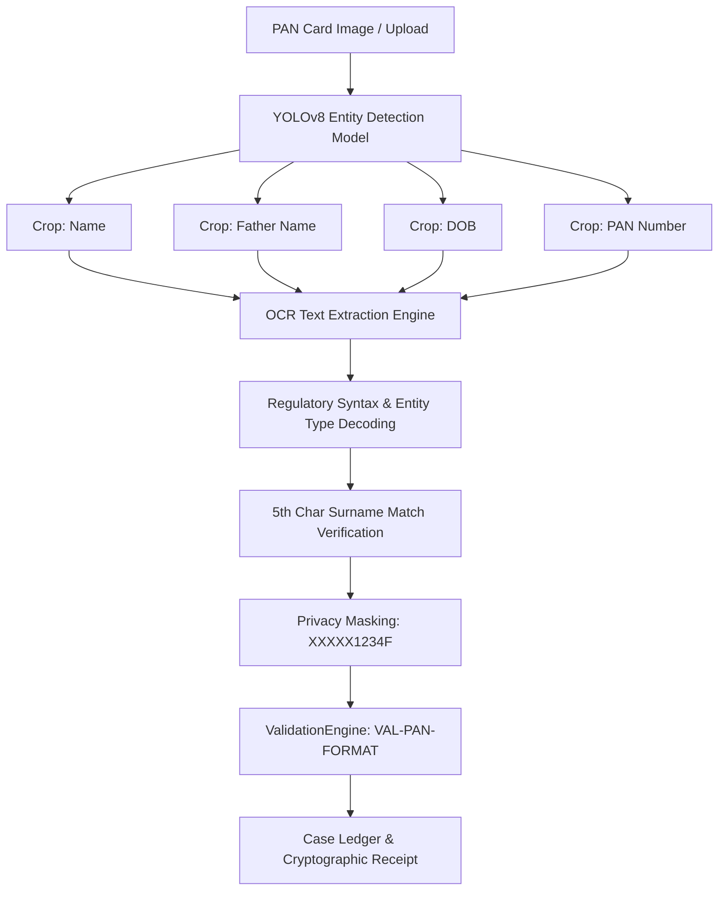

# PAN Card YOLOv8 Entity Detection & Validation Engine Guide

## 1. Overview & Dataset Profile

This guide documents the end-to-end integration of the **PAN (Permanent Account Number) Card Entity Detection** dataset into the AI Identity & Digital Trust Automation Platform.

- **Dataset Source:** [Roboflow Universe — panocr/ocr-qaxqg (v5)](https://universe.roboflow.com/panocr/ocr-qaxqg)
- **License:** CC BY 4.0
- **Total Images:** 1,726 images
- **Annotation Format:** YOLOv8 bounding boxes
- **Target Annotated Classes:**
  1. `pan_number` — 10-character alphanumeric PAN identifier (`AAAAA9999A`)
  2. `name` — Citizen / Taxpayer legal full name
  3. `father_name` — Father's / Guardian's name
  4. `dob` — Date of Birth (or Date of Incorporation: `DD/MM/YYYY`)

---

## 2. Regulatory Structure & Verification Logic

A PAN card issued by the Income Tax Department of India follows a strict 10-character alphanumeric format:

$$\underbrace{\text{A B C}}_{\text{Series}} \quad \underbrace{\text{P}}_{\text{Entity Type}} \quad \underbrace{\text{S}}_{\text{Surname Initial}} \quad \underbrace{1 \ 2 \ 3 \ 4}_{\text{Sequential Digits}} \quad \underbrace{\text{F}}_{\text{Check Digit}}$$

### 4th Character — Entity / Taxpayer Type Decoding:
| Code | Entity Classification |
|:---:|---|
| **P** | Individual / Person |
| **C** | Company / Corporation |
| **H** | Hindu Undivided Family (HUF) |
| **A** | Association of Persons (AOP) |
| **T** | Trust |
| **B** | Body of Individuals (BOI) |
| **L** | Local Authority |
| **J** | Artificial Juridical Person |
| **G** | Government Agency |
| **F** | Firm / Limited Liability Partnership (LLP) |

### 5th Character — Surname Consistency Check:
For individual taxpayers (`'P'`), the 5th character strictly corresponds to the **first letter of the holder's surname (last name)**. The platform's [`pancard_service.py`](file:///c:/Users/sakth/ai%20identity%20and%20digital%20automation/backend/app/services/pancard_service.py) automatically extracts the applicant's surname from profile assertions and verifies consistency.

---

## 3. Subsystem Architecture



---

## 4. Downloading the Dataset & Training the Model

The platform includes a dedicated automation script: [`scripts/train_pancard_yolov8.py`](file:///c:/Users/sakth/ai%20identity%20and%20digital%20automation/scripts/train_pancard_yolov8.py).

### Step 4.1: Verify Script in Dry-Run Mode
```bash
python scripts/train_pancard_yolov8.py --dry-run
```

### Step 4.2: Download the Dataset Only
To download the dataset in YOLOv8 format using your Roboflow API key:
```bash
python scripts/train_pancard_yolov8.py \
    --api-key YOUR_ROBOFLOW_API_KEY \
    --download-only
```

### Step 4.3: Full Model Training & Weight Export
Train a YOLOv8 nano model (`yolov8n.pt`) for 50 epochs:
```bash
python scripts/train_pancard_yolov8.py \
    --api-key YOUR_ROBOFLOW_API_KEY \
    --model yolov8n.pt \
    --epochs 50 \
    --batch 16 \
    --imgsz 640 \
    --export-onnx
```

When training completes, the script automatically copies `best.pt` to:
`backend/app/models/weights/pancard_yolov8.pt`

Once this file is present, `PANCardEntityDetectionService` automatically switches from heuristic fallback to live YOLOv8 model inference.

---

## 5. Backend REST API Endpoints

The PAN card subsystem exposes the following endpoints under `/api/v1/pancard`:

### 1. `POST /api/v1/pancard/validate-number`
Validates any 10-character PAN against regulatory syntax and verifies surname initial matching.

- **Request Body:**
  ```json
  {
    "pan_number": "ABCPS1234F",
    "applicant_surname": "Sharma"
  }
  ```
- **Response (HTTP 200 OK):**
  ```json
  {
    "is_valid": true,
    "error_code": null,
    "message": "PAN number is structurally and regulatorily valid (Individual / Person)",
    "cleaned_number": "ABCPS1234F",
    "masked_number": "XXXXX1234F",
    "holder_type_code": "P",
    "holder_type_description": "Individual / Person",
    "surname_match": true,
    "sha256_hash": "4b128ff9fe97ee01baeed15abecf83c75c5f3c4074eedce234d5bd26dc7de22a"
  }
  ```

### 2. `POST /api/v1/pancard/detect-and-extract`
Performs entity detection, OCR extraction, and regulatory checks from an uploaded image or default synthetic sample.

- **Request:** Multipart form upload (`file`) or empty body (runs synthetic PAN test).
- **Response (HTTP 200 OK):**
  ```json
  {
    "status": "SUCCESS",
    "case_id": null,
    "file_id": "upload_direct",
    "detected_entities": {
      "name": { "text": "AARAV SHARMA", "confidence": 0.95, "bbox": {...} },
      "father_name": { "text": "RAMESH SHARMA", "confidence": 0.92, "bbox": {...} },
      "dob": { "text": "1994-08-15", "confidence": 0.93, "bbox": {...} },
      "pan_number": { "text": "ABCPS1234F", "confidence": 0.98, "bbox": {...} }
    },
    "extracted_fields": {
      "full_name": "AARAV SHARMA",
      "father_name": "RAMESH SHARMA",
      "date_of_birth": "1994-08-15",
      "document_number": "ABCPS1234F",
      "masked_document_number": "XXXXX1234F",
      "holder_type": "Individual / Person",
      "country": "IND"
    },
    "bounding_boxes": [...],
    "pan_valid": true,
    "masked_number": "XXXXX1234F",
    "detection_method": "HEURISTIC_SYNTHETIC_DETECTOR",
    "extracted_at": "2026-10-15T03:00:45.123456Z"
  }
  ```

### 3. `GET /api/v1/pancard/sample-image`
Returns a watermarked synthetic PAN card image (`image/png`) for front-end demonstration and development.

---

## 6. Verification & Automated Tests

A dedicated test suite validates the entire PAN card pipeline:

```bash
# Run PAN card test suite
python -m pytest tests/backend/test_pancard_pipeline.py -v
```

**Test Coverage Highlights:**
- `test_pan_regulatory_validation_individual`: Validates 4th character `'P'`.
- `test_pan_regulatory_validation_corporate_and_trust`: Validates company `'C'` and trust `'T'`.
- `test_pan_surname_mismatch_detected`: Flags discrepancies in 5th char vs applicant surname.
- `test_pan_invalid_format_and_empty`: Validates length and syntax rejections.
- `test_pan_privacy_masking`: Validates 5-character masking (`XXXXX1234F`).
- `test_synthetic_pan_generation`: Tests watermarked template generation.
- `test_pan_entity_detection_and_extraction`: Tests entity bounding boxes and text extraction.
- `test_validation_engine_pan_valid`: Tests `ValidationEngine` rule `VAL-PAN-FORMAT`.
- `test_validation_engine_pan_invalid_format`: Tests failure reporting on corrupt formats.
- `test_api_pan_*`: Tests REST API endpoints on live server.
