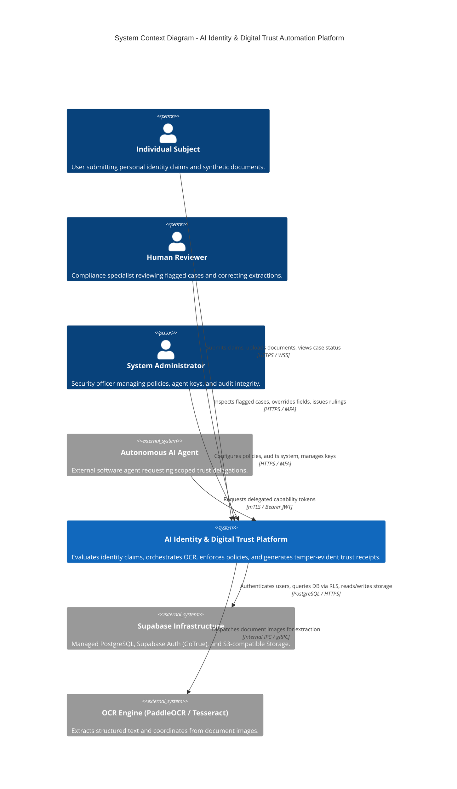
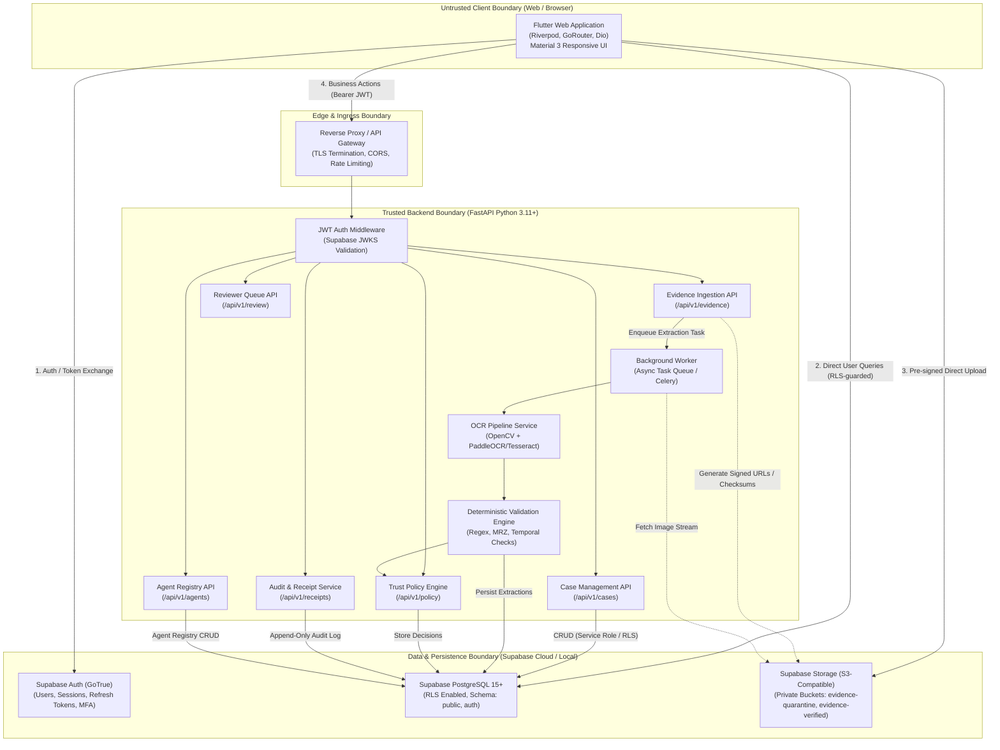
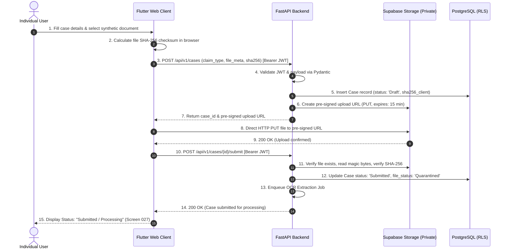
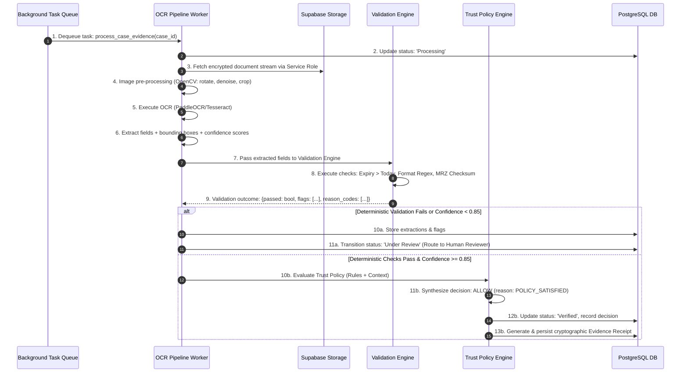
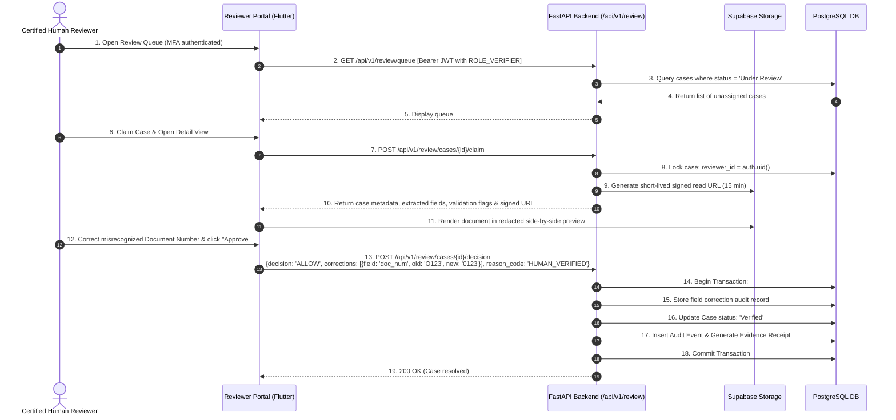
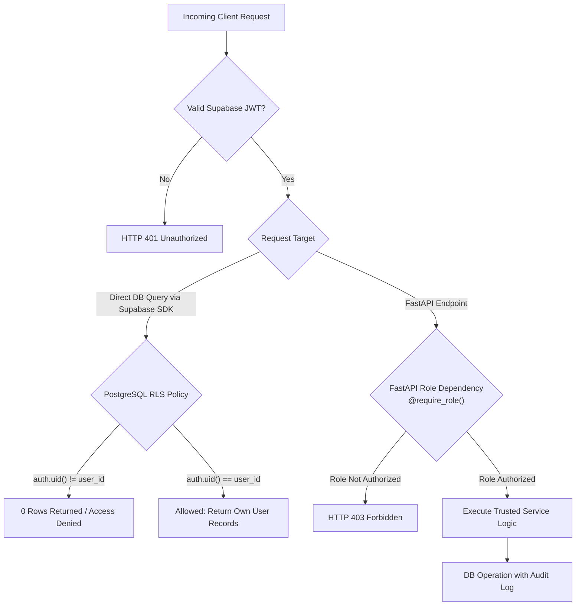
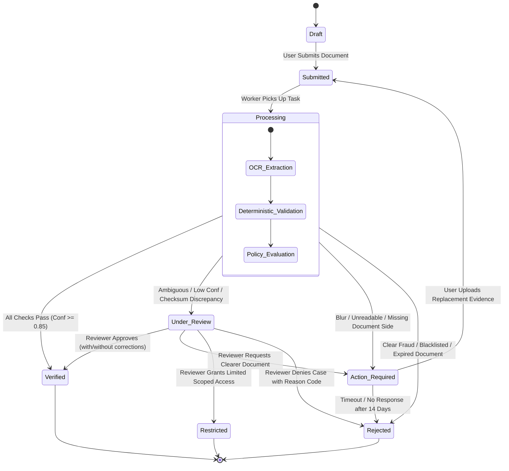
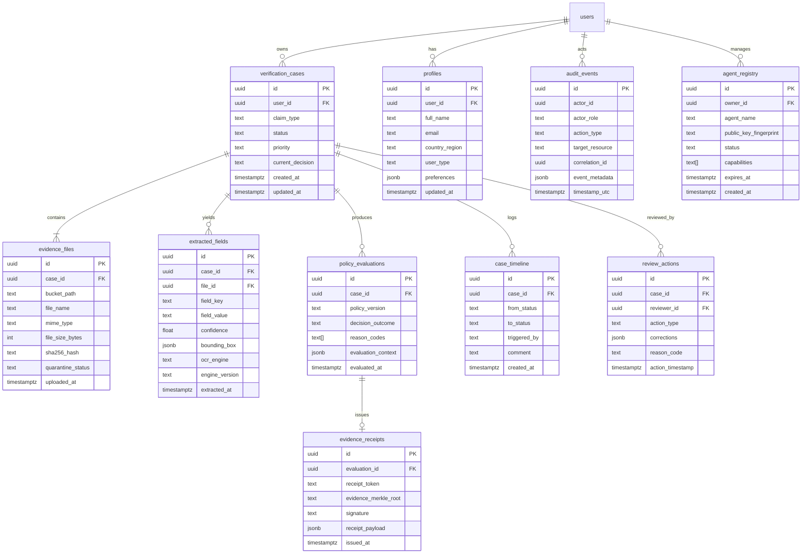

# AI Identity & Digital Trust Automation Platform
## Phase 2 — System Architecture & Technical Design

**Document Version:** 1.0  
**Phase:** 2 (System Architecture)  
**Status:** Complete / Ready for Review  
**Date:** 14 October 2026  
**Author:** AI System Architect & Antigravity Assistant  
**Approved By:** Pending Project Owner Approval  

---

## 1. Architectural Vision & Core Principles

The AI Identity & Digital Trust Automation Platform is engineered as a secure, privacy-preserving, and explainable trust evaluation system. It validates claims, digital identity documents, corporate affiliations, and autonomous AI-agent authorizations.

### Core Architectural Principles:
1. **Explainability & Contextual Trust:** Every system evaluation outputs a contextual decision (`ALLOW`, `VERIFY`, `RESTRICT`, `BLOCK`) accompanied by standardized, machine-readable reason codes. Automated scores are never treated as character judgments.
2. **Zero-Trust & Least Privilege:** Client applications are considered untrusted. PostgreSQL Row-Level Security (RLS) is enforced at the database layer; FastAPI strictly validates cryptographic bearer tokens on every request; server-only secrets never enter client-side bundles.
3. **Fail-Closed by Design:** Infrastructure errors, unparseable documents, model timeouts, or OCR service outages must gracefully default to `VERIFY` (human review required) or `BLOCK`, never defaulting to `ALLOW`.
4. **Data Minimization & Provenance:** Raw documents are kept in quarantined, private storage with access granted only via short-lived signed URLs ($\le 15\text{ min}$). All extracted data retains provenance metadata (engine version, bounding box, confidence score).
5. **Separation of Concerns:** Supabase serves as the single source of truth for identity authentication, relational persistence, and object storage. FastAPI serves as the trusted orchestration engine for business rules, OCR processing, policy synthesis, and audit receipts.

---

## 2. High-Level Architecture (C4 Model)

### 2.1 C4 Level 1: System Context Diagram



---

### 2.2 C4 Level 2: Container Diagram



---

## 3. Component Architecture & Inter-Service Communication

### 3.1 Frontend Architecture (Flutter Web)
The frontend is constructed using Flutter Web with Material 3, Riverpod for reactive state management, and GoRouter for declarative navigation.

- **Presentation Layer:** Modular screens (Screens 001–027, User Profile 022, Verification Status 027) built with reusable widgets.
- **State Management (Riverpod):**
  - `authProvider`: Manages authentication state, user session, and role claims.
  - `verificationCaseProvider`: Manages case lifecycle, real-time status updates, and timeline transitions.
  - `evidenceUploadProvider`: Coordinates chunked uploads, checksum calculations, and pre-signed URL acquisition.
  - `reviewerQueueProvider`: Specialized state for `ROLE_VERIFIER` displaying pending cases and field comparison.
- **Networking & API Clients:**
  - `SupabaseClient`: Direct client for session management, user profile subscriptions, and real-time case status listeners.
  - `DioClient`: Configured with interceptors to inject Supabase JWT tokens, handle retries, and parse standardized error envelopes from FastAPI.

### 3.2 Backend Service Architecture (FastAPI)
The backend is structured as a modular Python service enforcing strict clean-architecture separation:

```
backend/
├── app/
│   ├── api/
│   │   ├── v1/
│   │   │   ├── router.py             # Root v1 API router
│   │   │   ├── cases.py              # Case lifecycle endpoints
│   │   │   ├── evidence.py           # Pre-signed upload & checksum validation
│   │   │   ├── review.py             # Human reviewer workbench endpoints
│   │   │   ├── policy.py             # Trust evaluation & decision endpoint
│   │   │   ├── receipts.py           # Evidence receipt generation & verification
│   │   │   └── agents.py             # AI-agent registration & delegation
│   ├── core/
│   │   ├── config.py                 # Pydantic Settings & environment validation
│   │   ├── security.py               # JWT decode, Supabase JWKS, role authorization
│   │   ├── errors.py                 # Standardized HTTPException handlers
│   │   └── logging.py                # Redacted structured JSON logging
│   ├── services/
│   │   ├── case_service.py           # Verification state machine logic
│   │   ├── evidence_service.py       # Checksum, quarantine, and storage service
│   │   ├── ocr_service.py            # PaddleOCR/Tesseract orchestration
│   │   ├── validation_service.py     # Deterministic rule checks (MRZ, expiry)
│   │   ├── policy_engine.py          # Trust engine (ALLOW, VERIFY, RESTRICT, BLOCK)
│   │   └── receipt_service.py        # Cryptographic receipt creation & hash chaining
│   ├── schemas/                      # Pydantic v2 request/response models
│   └── workers/                      # Background task definitions
```

---

## 4. Trust Boundaries & Threat Modeling (STRIDE)

### 4.1 Trust Boundaries

```
[ UNTRUSTED ZONE: Browser / Public Web ]
═════════════════════════════════════════════════════════════════════  ◄── Boundary 1: TLS / CORS / CSP
[ EDGE INGRESS: Reverse Proxy / Cloudflare ]
─────────────────────────────────────────────────────────────────────  ◄── Boundary 2: JWT Bearer Token Auth
[ AUTHENTICATED APP ZONE: FastAPI Services & Supabase RLS Engine ]
═════════════════════════════════════════════════════════════════════  ◄── Boundary 3: Internal VPC / Service Role Key
[ SECURE DATA ZONE: Private PostgreSQL, Quarantined S3 Buckets, OCR ]
```

- **Boundary 1 (Browser to Edge):** Untrusted public traffic. Vulnerable to interception, XSS, and CSRF. Enforced via TLS 1.3, strict Content Security Policy (CSP), and origin checks.
- **Boundary 2 (Edge to Application Services):** Requests must carry a cryptographically valid Supabase JWT. Unauthenticated requests are rejected at the gateway.
- **Boundary 3 (Backend to Persistence/Storage):** The FastAPI backend connects to PostgreSQL using pooled connections and interacts with Supabase Storage using the server-side `service_role` key. Direct client access to raw evidence buckets is blocked; clients only receive signed URLs with $\le 15\text{ minute}$ expirations.

### 4.2 STRIDE Threat Analysis & Mitigations

| Threat Category | Specific System Threat | Architectural Mitigation |
|---|---|---|
| **S — Spoofing** | Adversary impersonates a user or reviewer to access cases or modify rulings. | • Supabase Auth with asymmetric JWT verification.<br/>• Reviewer endpoints require verified `ROLE_VERIFIER` role + MFA.<br/>• Short-lived access tokens (1 hour) with automatic rotation. |
| **T — Tampering** | Adversary alters uploaded synthetic evidence after submission or tampers with OCR output. | • Client & server compute SHA-256 checksums immediately upon receipt.<br/>• Files stored in immutable private buckets.<br/>• Field corrections by reviewers are logged in append-only audit tables with original vs. new values. |
| **R — Repudiation** | User or reviewer denies submitting a document or rendering a biased ruling. | • Append-only audit log capturing `actor_id`, `actor_role`, `correlation_id`, `ip_address`, `timestamp_utc`, and decision hash.<br/>• Cryptographic Evidence Receipts signed with server private key. |
| **I — Information Disclosure** | Raw identity documents or unredacted PII leaked in public URLs, logs, or error responses. | • No public storage buckets.<br/>• Signed URLs expire in $\le 15\text{ minutes}$.<br/>• Structured logs redact all PII fields (national IDs, names, dates of birth).<br/>• Database tables protected by PostgreSQL RLS. |
| **D — Denial of Service** | Oversized or zip-bomb uploads exhaust server memory or OCR CPU resources. | • Upload size capped at 10 MB enforced at storage bucket policy.<br/>• Magic-byte verification prior to OCR dispatch.<br/>• Asynchronous processing queue with worker concurrency limits and timeouts. |
| **E — Elevation of Privilege** | Normal user accesses reviewer queue or calls policy decision endpoints directly. | • Database-level RLS prevents user from reading foreign cases (`auth.uid() = user_id`).<br/>• FastAPI dependency injection (`require_role("ROLE_VERIFIER")`) validates RBAC claims. |

---

## 5. Sensitive Data Flows (Sequence Diagrams)

### 5.1 Data Flow 1: Case Creation & Secure Evidence Upload



---

### 5.2 Data Flow 2: Asynchronous OCR Extraction & Deterministic Validation



---

### 5.3 Data Flow 3: Human Reviewer Workbench & Escalation



---

## 6. Authentication & Authorization Paths

### 6.1 Authentication Token Flow
1. **Client Authentication:** Flutter Web interacts with Supabase Auth (`supabase.auth.signInWithPassword`). Supabase validates credentials and issues an asymmetric JWT signed with the project's ECDSA/HMAC secret.
2. **Token Passing:** Flutter client stores session securely. Every request to FastAPI includes header:
   $$\text{Authorization: Bearer } \langle\text{Supabase\_JWT}\rangle$$
3. **Backend JWT Validation:**
   - FastAPI `security.py` decodes the JWT using Supabase public JWKS / JWT Secret.
   - Verifies claims: `iss` (Supabase URL), `exp` (not expired), `aud` (`authenticated`).
   - Extracts subject identity: `sub` (User UUID) and `role` (`authenticated`).
   - Queries `user_roles` or decodes app metadata to resolve application roles (`ROLE_SUBJECT`, `ROLE_VERIFIER`, `ROLE_SYS_ADMIN`).

### 6.2 Dual-Layer Authorization Architecture



---

## 7. Failure Handling, Resilience & Escalation

### 7.1 Failure Mode Matrix & Fail-Closed Behavior

| Component / Subsystem | Failure Scenario | System Reaction | User/Reviewer Impact | Policy Decision |
|---|---|---|---|:---:|
| **Storage Upload** | Upload interrupted or SHA-256 mismatch | Mark file as `corrupted`; do not trigger OCR | Prompt user on Screen 027 to retry upload | `None` (Pre-evaluation) |
| **OCR Pipeline** | Unreadable image, resolution $< 300\text{ DPI}$, extreme blur | Catch `LowQualityImageException`; flag image | Route case to `Action Required` with reason `DOC_UNREADABLE` | `VERIFY` |
| **OCR Service Crash** | OCR process terminates or times out ($> 30\text{s}$) | Worker catches timeout; retry $3\times$ with exponential backoff; if persistent, fail | Case moves to `Under Review` with reason `OCR_SERVICE_TIMEOUT` | `VERIFY` |
| **Deterministic Validation** | Document expiration date is in the past | Flag `VAL-EXPIRY-FAIL` | User sees clear explanation: document has expired | `BLOCK` |
| **Deterministic Validation** | MRZ checksum does not match passport line | Flag `VAL-MRZ-CHECKSUM-FAIL` | If confidence $< 0.85$, route to Reviewer; if confidence high, mark suspicious | `VERIFY` or `BLOCK` |
| **Database Unavailable** | PostgreSQL connection pool timeout | FastAPI returns HTTP 503; client retries with jitter | Toast error displayed; operation safely retried | `None` (Fail closed) |
| **Policy Evaluation** | Unhandled policy rule or conflicting assertion | Fallback catch-all triggers; logs incident with correlation ID | System automatically flags case for human supervisor | `BLOCK` / `VERIFY` |

### 7.2 Human Review Escalation State Machine



---

## 8. Relational Data Model & Database Schema (ERD)



---

## 9. Security & Privacy Guarantees

1. **Zero Secret Leakage in Flutter Web:**
   - The Flutter Web build strictly compiles with `SUPABASE_ANON_KEY`.
   - The `SUPABASE_SERVICE_ROLE_KEY` is provisioned exclusively as an environment variable in the containerized FastAPI server.
   - Code repositories and CI/CD pipelines enforce automated scanning to block accidental secret commits.
2. **Private Storage & Pre-Signed Access:**
   - Buckets (`evidence-quarantine`, `evidence-verified`) disallow public reads (`public: false`).
   - Document previews for reviewers use presigned URLs generated on-demand with a maximum lifetime of 15 minutes.
3. **Data Anonymization & Audit Safety:**
   - Raw documents are purged upon retention expiry; only cryptographic hashes and non-identifying metadata remain in the audit receipts.
   - Audit event payloads mask sensitive national ID numbers (e.g. `XXXX-XX-1234`).
4. **Deterministic & Rule-Based Trust Transparency:**
   - Every decision is 100% reproducible given the same input evidence, extracted fields, and versioned policy ruleset.

---

## 10. REST API Endpoint Specifications (OpenAPI Contract Blueprint)

All backend endpoints are hosted under prefix `/api/v1` and require an `Authorization: Bearer <JWT>` header unless explicitly marked public.

| Endpoint | Method | Required Role | Request Body (JSON) | Response (JSON) | Status Codes | Description |
|---|:---:|:---:|---|---|:---:|---|
| `/health` | `GET` | Public | None | `{"status": "ok", "version": "1.0.0"}` | 200 | Liveness & readiness probe |
| `/cases` | `POST` | `ROLE_SUBJECT` | `{"claim_type": "SYNTH_NAT_ID_V1", "metadata": {...}}` | `{"case_id": "uuid", "status": "Draft", "created_at": "..."}` | 201, 400, 401 | Initialize new verification case |
| `/cases` | `GET` | `ROLE_SUBJECT` | None (Query: `?limit=20&offset=0`) | `{"cases": [...], "total": 1}` | 200, 401 | List user's verification cases |
| `/cases/{id}` | `GET` | `ROLE_SUBJECT` / `ROLE_VERIFIER` | None | `{"id": "...", "status": "...", "timeline": [...]}` | 200, 403, 404 | Get single case details & timeline |
| `/cases/{id}/submit` | `POST` | `ROLE_SUBJECT` | `{"idempotency_key": "uuid"}` | `{"case_id": "...", "status": "Submitted"}` | 200, 400, 409 | Submit case for OCR & validation |
| `/evidence/upload-url` | `POST` | `ROLE_SUBJECT` | `{"case_id": "uuid", "file_name": "...", "mime_type": "image/jpeg", "sha256": "..."}` | `{"upload_url": "https://...", "file_id": "uuid", "expires_in": 900}` | 200, 400, 403 | Generate signed upload URL |
| `/evidence/{file_id}/verify` | `POST` | `ROLE_SUBJECT` | None | `{"file_id": "uuid", "sha256_verified": true, "status": "Quarantined"}` | 200, 400, 422 | Confirm upload & verify checksum |
| `/review/queue` | `GET` | `ROLE_VERIFIER` | None (Query: `?status=Under Review`) | `{"pending_cases": [...], "queue_length": 5}` | 200, 403 | Fetch cases requiring review |
| `/review/cases/{id}/claim` | `POST` | `ROLE_VERIFIER` | None | `{"case_id": "...", "reviewer_id": "uuid", "status": "Claimed"}` | 200, 409 | Lock case to current reviewer |
| `/review/cases/{id}/decision` | `POST` | `ROLE_VERIFIER` | `{"decision": "ALLOW", "corrections": [...], "reason_code": "DEC_ALLOW_HUMAN_OVERRIDE", "comment": "..."}` | `{"case_id": "...", "new_status": "Verified", "receipt_id": "uuid"}` | 200, 400, 403 | Submit reviewer manual determination |
| `/policy/evaluate` | `POST` | Internal / Service | `{"case_id": "uuid", "extracted_fields": {...}}` | `{"decision": "ALLOW", "reason_codes": [...], "confidence": 0.94}` | 200, 400, 500 | Trigger policy engine rules |
| `/receipts/{case_id}` | `GET` | `ROLE_SUBJECT` / `ROLE_VERIFIER` | None | `{"receipt_id": "uuid", "merkle_root": "...", "signature": "...", "payload": {...}}` | 200, 403, 404 | Download cryptographic evidence receipt |

---

## 11. Database Schema DDL & PostgreSQL RLS Blueprint

The following executable SQL specification defines the foundation for the Phase 4–5 database migrations:

```sql
-- Enable UUID extension
CREATE EXTENSION IF NOT EXISTS "uuid-ossp";

-- 1. Profiles Table
CREATE TABLE public.profiles (
    id UUID PRIMARY KEY DEFAULT gen_random_uuid(),
    user_id UUID NOT NULL REFERENCES auth.users(id) ON DELETE CASCADE UNIQUE,
    full_name TEXT NOT NULL,
    email TEXT NOT NULL,
    country_region TEXT DEFAULT 'GLOBAL',
    user_type TEXT NOT NULL DEFAULT 'INDIVIDUAL' CHECK (user_type IN ('INDIVIDUAL', 'ORGANIZATION', 'AGENT')),
    preferences JSONB DEFAULT '{}'::jsonb,
    created_at TIMESTAMPTZ DEFAULT timezone('utc'::text, now()) NOT NULL,
    updated_at TIMESTAMPTZ DEFAULT timezone('utc'::text, now()) NOT NULL
);

-- 2. Verification Cases Table
CREATE TABLE public.verification_cases (
    id UUID PRIMARY KEY DEFAULT gen_random_uuid(),
    user_id UUID NOT NULL REFERENCES auth.users(id) ON DELETE CASCADE,
    claim_type TEXT NOT NULL,
    status TEXT NOT NULL DEFAULT 'Draft' CHECK (status IN ('Draft', 'Submitted', 'Processing', 'Under Review', 'Action Required', 'Verified', 'Rejected', 'Restricted')),
    priority TEXT NOT NULL DEFAULT 'NORMAL' CHECK (priority IN ('LOW', 'NORMAL', 'HIGH', 'URGENT')),
    assigned_reviewer_id UUID REFERENCES auth.users(id),
    current_decision TEXT CHECK (current_decision IN ('ALLOW', 'VERIFY', 'RESTRICT', 'BLOCK')),
    created_at TIMESTAMPTZ DEFAULT timezone('utc'::text, now()) NOT NULL,
    updated_at TIMESTAMPTZ DEFAULT timezone('utc'::text, now()) NOT NULL
);

-- 3. Evidence Files Table
CREATE TABLE public.evidence_files (
    id UUID PRIMARY KEY DEFAULT gen_random_uuid(),
    case_id UUID NOT NULL REFERENCES public.verification_cases(id) ON DELETE CASCADE,
    bucket_path TEXT NOT NULL,
    file_name TEXT NOT NULL,
    mime_type TEXT NOT NULL CHECK (mime_type IN ('image/jpeg', 'image/png', 'application/pdf')),
    file_size_bytes BIGINT NOT NULL CHECK (file_size_bytes <= 10485760), -- 10 MB Max
    sha256_hash TEXT NOT NULL,
    quarantine_status TEXT NOT NULL DEFAULT 'QUARANTINED' CHECK (quarantine_status IN ('QUARANTINED', 'CLEARED', 'REJECTED')),
    uploaded_at TIMESTAMPTZ DEFAULT timezone('utc'::text, now()) NOT NULL
);

-- 4. Extracted Fields Table
CREATE TABLE public.extracted_fields (
    id UUID PRIMARY KEY DEFAULT gen_random_uuid(),
    case_id UUID NOT NULL REFERENCES public.verification_cases(id) ON DELETE CASCADE,
    file_id UUID NOT NULL REFERENCES public.evidence_files(id) ON DELETE CASCADE,
    field_key TEXT NOT NULL,
    field_value TEXT NOT NULL,
    confidence NUMERIC(4,3) NOT NULL CHECK (confidence >= 0.000 AND confidence <= 1.000),
    bounding_box JSONB,
    ocr_engine TEXT NOT NULL,
    engine_version TEXT NOT NULL,
    extracted_at TIMESTAMPTZ DEFAULT timezone('utc'::text, now()) NOT NULL
);

-- 5. Policy Evaluations Table
CREATE TABLE public.policy_evaluations (
    id UUID PRIMARY KEY DEFAULT gen_random_uuid(),
    case_id UUID NOT NULL REFERENCES public.verification_cases(id) ON DELETE CASCADE,
    policy_version TEXT NOT NULL,
    decision_outcome TEXT NOT NULL CHECK (decision_outcome IN ('ALLOW', 'VERIFY', 'RESTRICT', 'BLOCK')),
    reason_codes TEXT[] NOT NULL DEFAULT '{}',
    evaluation_context JSONB DEFAULT '{}'::jsonb,
    evaluated_at TIMESTAMPTZ DEFAULT timezone('utc'::text, now()) NOT NULL
);

-- 6. Evidence Receipts Table
CREATE TABLE public.evidence_receipts (
    id UUID PRIMARY KEY DEFAULT gen_random_uuid(),
    evaluation_id UUID NOT NULL REFERENCES public.policy_evaluations(id) ON DELETE CASCADE UNIQUE,
    receipt_token TEXT NOT NULL UNIQUE,
    evidence_merkle_root TEXT NOT NULL,
    signature TEXT NOT NULL,
    receipt_payload JSONB NOT NULL,
    issued_at TIMESTAMPTZ DEFAULT timezone('utc'::text, now()) NOT NULL
);

-- 7. Audit Events Table (Append-Only)
CREATE TABLE public.audit_events (
    id UUID PRIMARY KEY DEFAULT gen_random_uuid(),
    actor_id UUID,
    actor_role TEXT NOT NULL,
    action_type TEXT NOT NULL,
    target_resource TEXT NOT NULL,
    correlation_id UUID NOT NULL,
    event_metadata JSONB DEFAULT '{}'::jsonb,
    timestamp_utc TIMESTAMPTZ DEFAULT timezone('utc'::text, now()) NOT NULL
);

-- Indexes for High Performance
CREATE INDEX idx_cases_user_id ON public.verification_cases(user_id);
CREATE INDEX idx_cases_status ON public.verification_cases(status);
CREATE INDEX idx_evidence_case_id ON public.evidence_files(case_id);
CREATE INDEX idx_audit_correlation_id ON public.audit_events(correlation_id);
CREATE INDEX idx_audit_timestamp ON public.audit_events(timestamp_utc DESC);

-- Row-Level Security (RLS) Configuration
ALTER TABLE public.profiles ENABLE ROW LEVEL SECURITY;
ALTER TABLE public.verification_cases ENABLE ROW LEVEL SECURITY;
ALTER TABLE public.evidence_files ENABLE ROW LEVEL SECURITY;
ALTER TABLE public.policy_evaluations ENABLE ROW LEVEL SECURITY;
ALTER TABLE public.evidence_receipts ENABLE ROW LEVEL SECURITY;

-- Subject Access: Only see own records
CREATE POLICY "Users can view own profile" 
    ON public.profiles FOR SELECT USING (auth.uid() = user_id);
CREATE POLICY "Users can update own profile" 
    ON public.profiles FOR UPDATE USING (auth.uid() = user_id);

CREATE POLICY "Users can view own cases" 
    ON public.verification_cases FOR SELECT USING (auth.uid() = user_id);
CREATE POLICY "Users can create own cases" 
    ON public.verification_cases FOR INSERT WITH CHECK (auth.uid() = user_id);

CREATE POLICY "Users can view own evidence" 
    ON public.evidence_files FOR SELECT 
    USING (EXISTS (SELECT 1 FROM public.verification_cases WHERE id = evidence_files.case_id AND user_id = auth.uid()));

-- Reviewer Access: Allow verified reviewers to read assigned cases
CREATE POLICY "Reviewers can view assigned or queued cases" 
    ON public.verification_cases FOR SELECT 
    USING ((auth.jwt() -> 'app_metadata' ->> 'role') IN ('ROLE_VERIFIER', 'ROLE_SYS_ADMIN'));
```

---

## 12. Cryptographic Evidence Receipt Specification

Upon reaching an `ALLOW`, `RESTRICT`, or `BLOCK` decision, the platform generates an immutable JSON-LD Evidence Receipt:

```json
{
  "$schema": "https://identity-trust.platform/schemas/v1/receipt.json",
  "receipt_id": "urn:uuid:7f3a8b21-4190-4c3e-908a-0987654321ab",
  "issued_at": "2026-10-14T21:45:00.000Z",
  "issuer": {
    "platform_id": "ai-identity-trust-engine-v1",
    "public_key_fingerprint": "SHA256:7e8a9f0b1c2d3e4f5a6b7c8d9e0f1a2b3c4d5e6f7a8b9c0d1e2f3a4b5c6d7e8f"
  },
  "subject": {
    "user_id_hash": "SHA256:b10a8db164e0754105b7a99be72e3fe5"
  },
  "claim": {
    "case_id": "urn:uuid:6e2d1a09-3087-4b2d-8079-1827364529cd",
    "claim_type": "SYNTH_NAT_ID_V1",
    "evidence_sha256": "e3b0c44298fc1c149afbf4c8996fb92427ae41e4649b934ca495991b7852b855"
  },
  "determination": {
    "decision": "ALLOW",
    "reason_codes": ["DEC_ALLOW_SATISFIED"],
    "policy_version": "v1.2.0",
    "confidence_score": 0.962
  },
  "integrity": {
    "merkle_root": "8f3b2a1c0d9e8f7a6b5c4d3e2f1a0b9c8d7e6f5a4b3c2d1e0f9a8b7c6d5e4f3a",
    "algorithm": "ECDSA_P256_SHA256",
    "signature": "MEQCIQDe...4Xg=="
  }
}
```

---

## 13. Phase 2 Definition of Done Checklist

- [x] **System Context and Container Diagrams Created:** C4 Level 1 and Level 2 diagrams rendered in Section 2.
- [x] **Inter-Service Communication Defined:** Flutter, FastAPI, Supabase, and OCR engine communication protocols documented in Section 3.
- [x] **Trust Boundaries & Sensitive Data Flows Identified:** Trust boundaries, STRIDE threat model, and sequence diagrams detailed in Sections 4 and 5.
- [x] **Authentication & Authorization Paths Documented:** Dual-layer auth architecture (Supabase Auth, RLS, and FastAPI RBAC) defined in Section 6.
- [x] **Failure Handling & Escalation Defined:** Fail-closed matrix and human review state machine documented in Section 7.
- [x] **Database Schema & Relational ERD Formulated:** Schema and ERD diagram completed in Section 8.
- [x] **Security and Privacy Reviewed:** Zero secret leakage, signed URL controls, and PII masking documented in Section 9.
- [x] **REST API Specifications Documented:** Full OpenAPI contract table in Section 10.
- [x] **PostgreSQL DDL & RLS Blueprint Provided:** Executable SQL table definitions and RLS policies in Section 11.
- [x] **Cryptographic Evidence Receipt Specified:** JSON schema and integrity structure in Section 12.

---

## 14. Next Phase Gate

Upon approval of this System Architecture document by the project owner:
- **Proceed to Phase 3:** Repository Foundation (Folder organization for frontend, backend, database migrations, linting, environment templates, and baseline tests).

